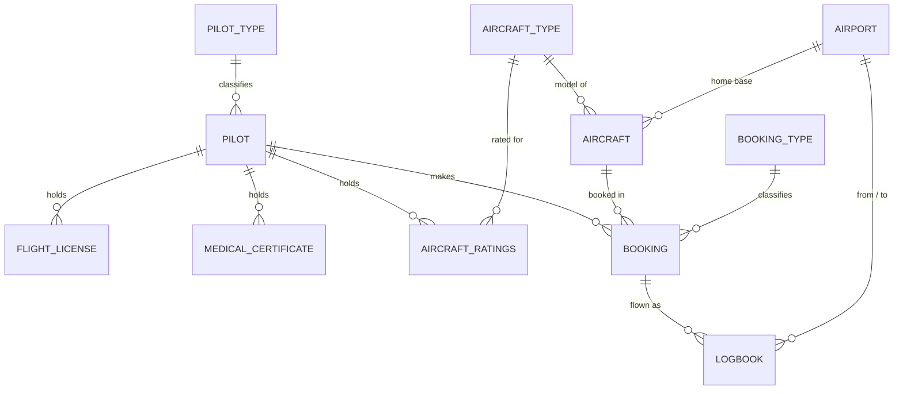

# Flight School API

REST API and PostgreSQL database for a flight school. It manages pilots, their licences, medical certificates and aircraft ratings, the fleet, aircraft bookings and the flight logbook, and produces booking reports.

*Developed with Afonso Cordeiro. Course: Data Management Systems, University of Coimbra, 2022/23.*

## Database

The schema is in [schema.sql](schema.sql) (11 tables). `insertion.py` creates it and loads the sample data from [`tabelas/`](tabelas/) (fictional pilots, aircraft, airports, bookings and flights).



## Endpoints

| Method | Endpoint | Description |
|---|---|---|
| GET | `/proj/pilot/<keyword>` | Search pilots by name, address or home airport |
| GET | `/proj/pilot/<pilot_id>` | Pilot details with ratings, bookings and flight logs |
| PUT | `/proj/pilot/<pilot_id>` | Update a pilot's data |
| POST | `/proj/aircraft` | Add an aircraft (rejects duplicate tail or serial numbers) |
| POST | `/proj/booking` | Book an aircraft. Students cannot book, the licence and medical certificate must be valid, and the aircraft and pilot must be free |
| GET | `/proj/booking/<day>-<month>-<year>` | List the bookings on a date |
| GET | `/proj/report/year_booking/<year>` | Top 10 pilots by number of bookings in a year, with booked hours |
| GET | `/proj/report/monthly_booking/<aircraft_id>` | Bookings per day for one aircraft over the last 30 days |
| POST | `/proj/flightlog` | Register a flight in the logbook, matched to its booking (±1 hour) |

All queries use parameterised SQL, and write operations are rolled back on error. A ready-to-use Postman collection is in [postman_collection.json](postman_collection.json).

## How to run

Requires a running PostgreSQL server.

1. Create a database called `trabalho`, or edit [config.json](config.json) with your database name and credentials.
2. Install the dependencies:
   ```bash
   pip install -r requirements.txt
   ```
3. Create the tables and load the sample data (this drops any existing tables with the same names):
   ```bash
   python insertion.py
   ```
4. Start the API on http://127.0.0.1:8080:
   ```bash
   python api.py
   ```

Example requests:

```bash
curl http://127.0.0.1:8080/proj/pilot/jack
curl http://127.0.0.1:8080/proj/report/year_booking/2022
curl -X POST http://127.0.0.1:8080/proj/aircraft -H "Content-Type: application/json" \
     -d '{"tail_number": "CS-ABC", "serial_number": 123456789, "category": "5", "home_airport": 3, "color": "Blue"}'
```

The slides from the final presentation (Portuguese) are in [docs/](docs/), along with the conceptual model exported from the ONDA modelling tool.

## Changes from the submitted version

- `api.py` and `insertion.py` now read `config.json` with `pd.read_json('config.json', typ='series')`. The submitted versions (`pd.read_json('config.json')` and `pd.read_csv('config.json')`) failed before connecting to the database.

## Known limitations

- `GET /proj/pilot/<pilot_id>` uses `NATURAL LEFT JOIN`, which matches tables on their shared `id` column rather than on `pilot_id`. The ratings, booking and log it returns can therefore belong to other pilots.
- `PUT /proj/pilot/<pilot_id>` reads the wrong payload fields when updating the licence and medical certificate.
- The monthly report compares only the day of the month, so bookings from other months are also counted.
- The overlap check for new bookings only looks at existing bookings that start inside the new time slot.
