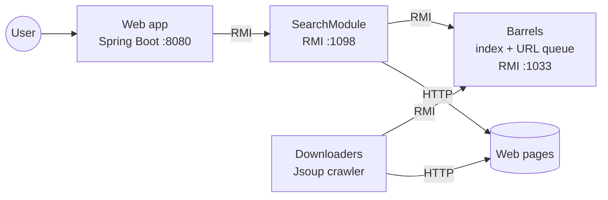

# Googol — Distributed Web Search Engine

A small web search engine built with Java RMI. Crawlers download pages (several can run at once), storage servers keep an inverted index, and a gateway answers queries ranked by the number of pages that link to each result. The second part of the project adds a web interface built with Spring Boot and Thymeleaf.

*Developed with Afonso Cordeiro. Course: Distributed Systems, University of Coimbra, 2022/23.*

## Architecture



| Component | Role |
|---|---|
| `Barrels` | RMI server that stores the inverted index (word → URLs), the pages that link to each URL, and the queue of URLs to visit |
| `Downloaders` | Crawler: takes URLs from the queue, downloads them with Jsoup and sends every word and outgoing link back to the Barrel |
| `SearchModule` | Gateway used by clients: intersects the URL sets of the query words, ranks the results by incoming links and returns 10 per page with title and first paragraph |
| Web app | Pages to search, to index a new URL and to list the pages that link to a URL |

Features:

- Multi-word search (pages must contain every word), with pagination.
- Ranking by the number of pages that link to each result.
- Indexing a URL on demand: it goes to the front of the crawl queue.
- Listing the pages that link to a given URL.
- Several Barrels can be listed in `Config.properties`: the Downloaders crawl from each Barrel's queue and the SearchModule picks a Barrel at random.

## How to run

Requires Java 17 or newer. Tested on Windows with Java 19.

**1. Backend.** Run these from the `backend` folder, because the components read `src/com/example/servingwebcontent/Config.properties` by relative path:

```bash
cd backend
curl -L -o jsoup-1.15.4.jar https://repo1.maven.org/maven2/org/jsoup/jsoup/1.15.4/jsoup-1.15.4.jar
javac -encoding UTF-8 -cp jsoup-1.15.4.jar -d out src/com/example/servingwebcontent/*.java
```

Then start each component in its own terminal, in this order:

```bash
java -cp "out;jsoup-1.15.4.jar" com.example.servingwebcontent.Barrels
java -cp "out;jsoup-1.15.4.jar" com.example.servingwebcontent.SearchModule
java -cp "out;jsoup-1.15.4.jar" com.example.servingwebcontent.Downloaders
```

On macOS or Linux, use `:` instead of `;` in the classpath.

**2. Web interface.**

```bash
cd web
./mvnw spring-boot:run        # Windows: mvnw.cmd spring-boot:run
```

Open http://localhost:8080, index a URL (for example `https://info.cern.ch/hypertext/WWW/TheProject.html`), wait a few seconds for the crawler, then search for a word such as `hypertext`.

## Changes from the submitted version

- `web/src/main/java/.../ServingWebContentApplication.java`: removed a servlet bean that referenced `Example`, a class from the course's Spring Boot template that is not part of this project. Without this change the web app does not compile.

## Known limitations

- The Downloader stops on its first error: a page that fails to download (for example HTTP 404) or an empty URL queue ends the process.
- The index lives in memory only, so restarting the Barrels loses it.
- With more than one Barrel the index is not replicated: each page is stored only in the Barrel whose queue it came from, so a search can miss results.
- Every search downloads each result page again to show its title and paragraph, which makes queries with many results slow.
- The web app tries to read `Config.properites` (typo), so it always falls back to `localhost` for the SearchModule.
